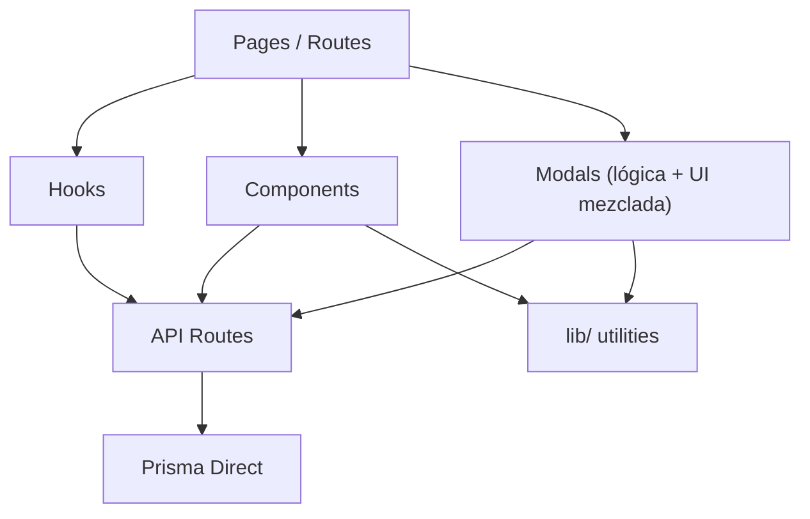
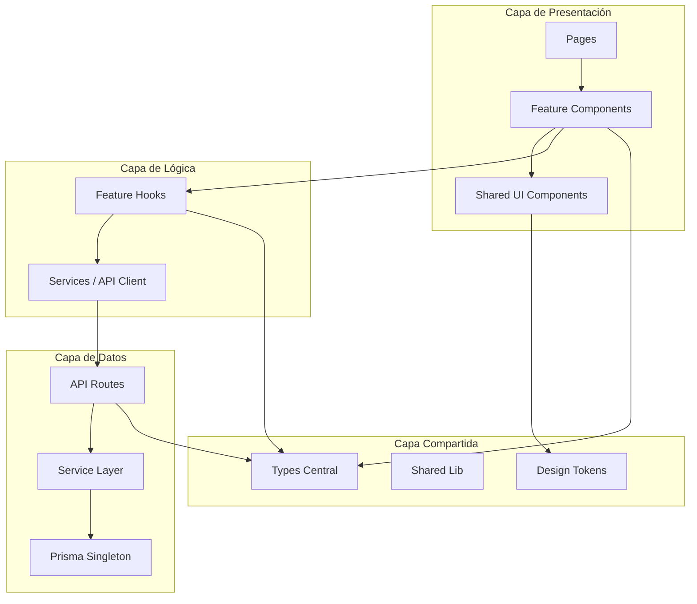

# 🏗️ Plan de Refactorización Arquitectónica — Restaurant System

> **Estado al 2026-05-14**: Fases 1-7 completadas. Limpieza de `src/lib` y centralización de servicios en marcha. Build ✅

## 1. Arquitectura Actual: Diagnóstico

### Stack Tecnológico
| Capa | Tecnología | Versión |
|------|-----------|---------|
| Framework | Next.js (App Router) | 15.5.x |
| UI | React + Radix UI + Tailwind v4 | 19.1 |
| ORM | Prisma (SQLite) | 6.12 |
| Auth | NextAuth v4 | 4.24 |
| Realtime | Socket.IO (custom server.js) | 4.8 |
| Printing | Custom thermal printer lib | — |

### Patrón Arquitectónico Actual
**Monolítico Page-Driven (sin capas claras)**



> [!WARNING]
> No existe una **capa de servicios**, **tipos centralizados**, ni **componentes compartidos de diseño**. Cada módulo reinventa sus propias abstracciones.

---

## 2. Problemas Identificados (12 Críticos)

### 🔴 P1: Tipos Duplicados y Dispersos
Las interfaces `Ingredient`, `Product`, `Category` se redefinen en **cada archivo** que las necesita:
- [useInventory.ts](file:///c:/Users/JOSE/Desktop/Universidad/Restaurante/src/hooks/useInventory.ts#L7-L29) — define `Ingredient`
- [IngredientModal.tsx](file:///c:/Users/JOSE/Desktop/Universidad/Restaurante/src/components/IngredientModal.tsx#L17-L33) — redefine `Ingredient` (diferente)
- [useMenuData.ts](file:///c:/Users/JOSE/Desktop/Universidad/Restaurante/src/hooks/useMenuData.ts#L13-L26) — define `Product` con `recipe?: any`
- [ProductModal.tsx](file:///c:/Users/JOSE/Desktop/Universidad/Restaurante/src/components/ProductModal.tsx) — redefine `Product` internamente

**Impacto**: Cambiar un campo en la DB requiere editar 4+ archivos manualmente.

### 🔴 P2: Dos Librerías de Unidades Incompatibles
- `src/lib/ingredientUnits.ts` — sistema completo con categorías, conversiones y sugerencias
- `src/lib/unitConversions.ts` — sistema básico con solo kg/g y l/ml

**Impacto**: Un insumo registrado en "libras" en el inventario no aparece como opción válida en la receta del menú.

### 🔴 P3: Componentes UI Premium Duplicados
`SectionTitle` está definido **dentro** de:
- `IngredientModal.tsx` (línea 225)
- `ProductModal.tsx` (línea 341)

Otros patrones duplicados: overlay glassmorphism, footer de modal, labels técnicos.

### 🔴 P4: Modales Monolíticos (God Components)
`ProductModal.tsx` tiene **713 líneas** que mezclan:
- Estado del formulario
- Validación
- Llamadas a API (fetch)
- Lógica de conversión de unidades
- UI completa (JSX)

### 🟡 P5: API Routes sin Capa de Servicio
Cada `route.ts` contiene lógica de negocio directa con Prisma:
- [products/route.ts](file:///c:/Users/JOSE/Desktop/Universidad/Restaurante/src/app/api/products/route.ts) — 278 líneas, validación + queries inline
- Sin reutilización entre endpoints (ej: la lógica de "reactivar producto" no se puede llamar desde otro endpoint)

### 🟡 P6: Instancia de Prisma sin Singleton
```typescript
// products/route.ts línea 6
const prisma = new PrismaClient() // ⚠️ Nueva instancia por archivo
```
Debería usar el singleton de `src/lib/prisma.ts`.

### 🟡 P7: Hooks con Responsabilidades Mixtas
`useInventory.ts` maneja: fetching, filtrado, ordenamiento, paginación y selección. Son 5 responsabilidades en un solo hook.

### 🟡 P8: Convención de Nombres Inconsistente
| Patrón | Ejemplo | Problema |
|--------|---------|----------|
| `use-kebab-case` | `use-cart.ts`, `use-create-order.ts` | Módulo de pedidos |
| `useCamelCase` | `useInventory.ts`, `useMenuData.ts` | Módulo de inventario/menú |
| Mixto | `useDashboardStats.ts` vs `use-order-data.ts` | Sin estándar |

### 🟡 P9: Estado Global Ausente
No existe un store centralizado. Cada página hace sus propios fetches independientes. Si el inventario cambia, el menú no se entera hasta hacer refresh manual.

### 🟡 P10: Estructura de Componentes Plana
```
src/components/
├── ProductModal.tsx      # ← Componente de Menú
├── IngredientModal.tsx   # ← Componente de Inventario
├── OrderCart.tsx          # ← Componente de Pedidos
├── CategoryModal.tsx     # ← ¿De menú o inventario?
└── ... (30 archivos al mismo nivel)
```
No hay agrupación por feature/módulo.

### 🟢 P11: `server.js` usa `global.io`
Socket.IO se inyecta como variable global (`global.io`). Funciona pero es frágil y no tipado.

### 🟢 P12: Ausencia de Tests
No hay carpeta de tests. Para un proyecto universitario puede ser aceptable, pero limita la confianza al refactorizar.

---

## 3. Arquitectura Objetivo: Feature-Sliced



### Estructura de Carpetas Objetivo
```
src/
├── app/                          # Solo routing y layouts
│   ├── api/
│   │   ├── products/route.ts     # Thin handler → llama a services
│   │   └── ingredients/route.ts
│   ├── dashboard/
│   │   └── inventario/page.tsx   # Composición de features
│   └── menu/page.tsx
│
├── features/                     # 🆕 Feature-Sliced
│   ├── inventory/
│   │   ├── components/           # IngredientModal, IngredientTable, etc.
│   │   ├── hooks/                # useInventory, useInventoryAlerts
│   │   └── types.ts              # Ingredient, IngredientCategory
│   ├── menu/
│   │   ├── components/           # ProductModal, ProductTable, CategoryTable
│   │   ├── hooks/                # useMenuData
│   │   └── types.ts              # Product, Category, Recipe
│   ├── orders/
│   │   ├── components/
│   │   ├── hooks/
│   │   └── types.ts
│   └── shared/                   # Cross-feature components
│       ├── ui/                   # SectionTitle, ModalShell, PremiumInput
│       └── units/                # Sistema unificado de unidades
│
├── services/                     # 🆕 Business Logic Layer
│   ├── product.service.ts
│   ├── ingredient.service.ts
│   └── order.service.ts
│
├── types/                        # 🆕 Central Type Definitions
│   ├── models.ts                 # Generated from Prisma or manual
│   ├── api.ts                    # Request/Response types
│   └── index.ts                  # Re-exports
│
├── lib/                          # Pure utilities (no business logic)
│   ├── prisma.ts
│   ├── auth.ts
│   ├── units.ts                  # 🆕 Unified (merge of both)
│   └── utils.ts
│
└── components/                   # Truly shared (used by 3+ features)
    ├── ui/                       # Radix primitives (stays)
    ├── layout/                   # PageHeader, etc.
    └── providers.tsx
```

---

## 4. Plan de Ejecución por Fases

> [!IMPORTANT]
> Cada fase es **independiente** y **no rompe** la funcionalidad existente. Un modelo menos inteligente puede ejecutar una fase completa sin contexto de las demás.

---

### FASE 1: Tipos Centralizados (Prioridad Máxima)
**Objetivo**: Una sola fuente de verdad para todos los tipos del sistema.
**Riesgo**: Bajo. Solo mover/consolidar interfaces.
**Archivos a crear**:

#### Tarea 1.1: Crear `src/types/models.ts`
```typescript
// Extraer de useInventory.ts, IngredientModal.tsx, useMenuData.ts
export interface Ingredient {
  id: string
  name: string
  unit: string
  unitCategory?: string
  currentStock: number
  minStock: number
  maxStock?: number
  cost?: number
  categoryId?: string
  category?: IngredientCategory
  isActive: boolean
  status?: string       // Computed field (from useInventory)
  statusColor?: string
  statusText?: string
  stockPercentage?: number
  createdAt?: string
  updatedAt?: string
}

export interface IngredientCategory {
  id: string
  name: string
  description?: string
  color?: string
  isActive?: boolean
}

export interface Product {
  id: string
  name: string
  description: string | null
  price: number | string  // Decimal comes as string from Prisma
  isAvailable: boolean
  isActive: boolean
  categoryId: string
  category?: Category
  recipe?: Recipe | null
}

export interface Category {
  id: string
  name: string
  description?: string | null
  isActive: boolean
  productCount?: number
}

export interface Recipe {
  id: string
  productId: string
  instructions: string | null
  prepTime: number | null
  servings: number
  isActive: boolean
  ingredients: RecipeIngredient[]
}

export interface RecipeIngredient {
  id: string
  recipeId: string
  ingredientId: string
  quantity: number
  unit: string
  notes: string | null
  ingredient?: Ingredient
}
```

#### Tarea 1.2: Crear `src/types/index.ts`
```typescript
export * from './models'
```

#### Tarea 1.3: Migrar imports en archivos existentes
Reemplazar las interfaces locales en estos archivos por imports de `@/types`:
- `src/hooks/useInventory.ts` → eliminar líneas 7-29, añadir `import { Ingredient } from "@/types"`
- `src/hooks/useMenuData.ts` → eliminar líneas 5-26, añadir `import { Category, Product } from "@/types"`
- `src/components/IngredientModal.tsx` → eliminar líneas 17-40, añadir import
- `src/components/ProductModal.tsx` → eliminar interfaces locales, añadir import
- `src/app/dashboard/inventario/components/ingredient-table.tsx` → ya importa de useInventory, OK

**Verificación**: `pnpm run build` debe pasar sin errores de tipo.

---

### FASE 2: Unificación de Unidades
**Objetivo**: Un solo sistema de unidades para todo el proyecto.
**Riesgo**: Medio. Afecta la lógica de recetas.

#### Tarea 2.1: Crear `src/lib/units.ts` (merge)
Tomar `ingredientUnits.ts` como base (es superior) y añadir las funciones útiles de `unitConversions.ts`:
- `getCompatibleUnits()` de unitConversions → reimplementar usando UNIT_CATEGORIES
- `getUnitLabel()` de unitConversions → reimplementar usando la data de ingredientUnits
- `areUnitsCompatible()` → reimplementar
- `convertToBaseUnit()` → ya existe como `convertUnit()` en ingredientUnits

#### Tarea 2.2: Migrar `ProductModal.tsx`
- Reemplazar `import { getCompatibleUnits, getUnitLabel } from "@/lib/unitConversions"` 
- Por `import { getCompatibleUnits, getUnitLabel } from "@/lib/units"`

#### Tarea 2.3: Migrar `IngredientModal.tsx`
- Reemplazar `import { ... } from "@/lib/ingredientUnits"`
- Por `import { ... } from "@/lib/units"`

#### Tarea 2.4: Buscar y reemplazar todas las referencias
```bash
grep -r "unitConversions\|ingredientUnits" src/ --include="*.ts" --include="*.tsx"
```
Migrar cada archivo encontrado.

#### Tarea 2.5: Eliminar archivos obsoletos
- Eliminar `src/lib/unitConversions.ts`
- Eliminar `src/lib/ingredientUnits.ts`

**Verificación**: Crear un producto con receta, verificar que las unidades del ingrediente se muestren correctamente.

---

### FASE 3: Componentes UI Compartidos
**Objetivo**: Extraer patrones de diseño repetidos a componentes reutilizables.
**Riesgo**: Bajo. Solo extracciones visuales.

#### Tarea 3.1: Crear `src/components/ui/modal-shell.tsx`
Extraer el patrón overlay + container + header + footer que se repite en IngredientModal y ProductModal:
```typescript
interface ModalShellProps {
  isOpen: boolean
  onClose: () => void
  icon: React.ReactNode
  title: string
  subtitle: string
  footer: React.ReactNode
  children: React.ReactNode
  maxWidth?: string  // "max-w-2xl" | "max-w-4xl"
}
```

#### Tarea 3.2: Crear `src/components/ui/section-title.tsx`
Extraer `SectionTitle` que está duplicado en ambos modales.

#### Tarea 3.3: Crear `src/components/ui/premium-input.tsx`
Extraer el patrón de input con label técnica:
```typescript
interface PremiumInputProps extends InputProps {
  label: string
  error?: string
  icon?: LucideIcon
}
```

#### Tarea 3.4: Refactorizar IngredientModal y ProductModal
Reemplazar el JSX inline con los nuevos componentes compartidos. El JSX de cada modal debería reducirse ~40%.

**Verificación**: Los modales deben verse idénticos antes y después.

---

### FASE 4: Singleton de Prisma
**Objetivo**: Eliminar instancias múltiples de PrismaClient.
**Riesgo**: Bajo.

#### Tarea 4.1: Buscar instancias incorrectas
```bash
grep -r "new PrismaClient()" src/app/api/ --include="*.ts"
```

#### Tarea 4.2: Reemplazar cada una
Cambiar `const prisma = new PrismaClient()` por `import prisma from "@/lib/prisma"` en cada archivo API encontrado.

**Verificación**: `pnpm run build` sin errores. Verificar que las queries sigan funcionando.

---

### FASE 5: Convención de Nombres
**Objetivo**: Estandarizar nomenclatura de hooks.
**Riesgo**: Medio. Requiere actualizar imports en múltiples archivos.

#### Regla: `useCamelCase.ts` para todos los hooks.

#### Archivos a renombrar:
| Actual | Nuevo |
|--------|-------|
| `use-cart.ts` | `useCart.ts` |
| `use-create-order.ts` | `useCreateOrder.ts` |
| `use-order-data.ts` | `useOrderData.ts` |
| `use-order-detail.ts` | `useOrderDetail.ts` |
| `use-order-payment.ts` | `useOrderPayment.ts` |
| `use-order-printing.ts` | `useOrderPrinting.ts` |
| `use-printer.ts` | `usePrinter.ts` |

#### Para cada archivo:
1. Renombrar el archivo
2. Buscar todas las importaciones: `grep -r "use-cart\|use-create-order" src/ --include="*.ts" --include="*.tsx"`
3. Actualizar cada import path

**Verificación**: `pnpm run build` sin errores.

---

### FASE 6: Reorganización por Features ✅ COMPLETA
**Estado**: Ejecutada. `src/features/` existe con 6 módulos (`inventory`, `menu`, `orders`, `dashboard`, `tables`, `billing`).
**Pendiente**: Eliminar bridges zombie cuando todos los imports estén migrados a `@/features/`.

> [!NOTE]
> Los imports en páginas ya fueron migrados directamente a `@/features/` en la sesión 2026-05-14. Los archivos bridge en `src/hooks/` y `src/components/` aún existen pero ya **no tienen referencias activas** (excepto bridges de componentes no migrados: `BulkStockAdjustModal`, `StockAdjustModal`, `IngredientCategoryModal`, `ConfirmDialog`, `NavigationProgress`).

#### Archivos bridge a eliminar (cuando se complete Tarea 7.1):
```
src/hooks/ → eliminar 15 bridges (useCart, useCreateOrder, useDashboardStats...)
src/components/ → eliminar 24 bridges (IngredientModal, ProductModal, OrderCart...)
```
**Mantener en `src/hooks/`**: `useNavigationLoading.ts`, `useSocket.ts` (shared reales)
**Mantener en `src/components/`**: `BulkStockAdjustModal.tsx`, `StockAdjustModal.tsx`, `IngredientCategoryModal.tsx`, `ConfirmDialog.tsx`, `NavigationProgress.tsx`


> [!CAUTION]
> Esta fase solo debe ejecutarse después de que las fases 1-5 estén completas y estables. Es la más invasiva y puede generar muchos conflictos de imports.

#### Estructura target para el módulo de Inventario:
```
src/features/inventory/
├── components/
│   ├── IngredientModal.tsx    (mover desde src/components/)
│   ├── IngredientTable.tsx    (mover desde src/app/dashboard/inventario/components/)
│   ├── InventoryStats.tsx     (mover)
│   ├── InventoryFilters.tsx   (mover)
│   └── CategoryTable.tsx      (mover)
├── hooks/
│   ├── useInventory.ts        (mover desde src/hooks/)
│   ├── useInventoryAlerts.ts  (mover)
│   └── useInventoryCategories.ts (mover)
└── index.ts                   (re-exportar todo)
```

#### Estructura target para el módulo de Menú:
```
src/features/menu/
├── components/
│   ├── ProductModal.tsx
│   ├── ProductTable.tsx
│   ├── CategoryModal.tsx
│   └── CategoryTable.tsx
├── hooks/
│   └── useMenuData.ts
└── index.ts
```

Para cada archivo movido:
1. Mover el archivo a su nueva ubicación
2. Crear alias en la ubicación original: `export { default } from "@/features/inventory/components/IngredientModal"`
3. Gradualmente migrar imports directos
4. Eliminar los alias cuando todos los imports estén migrados

**Verificación**: `pnpm run build` tras cada módulo movido.

---

## 5. Orden de Prioridad y Esfuerzo

| Fase | Prioridad | Esfuerzo | Impacto | Estado |
|------|-----------|----------|---------|--------|
| **F1: Tipos** | 🔴 Crítica | ~1h | Alto | ✅ Completa |
| **F2: Unidades** | 🔴 Crítica | ~2h | Alto | ✅ Completa |
| **F3: UI Compartidos** | 🟡 Alta | ~3h | Medio | ✅ Completa |
| **F4: Prisma Singleton** | 🟡 Alta | ~30min | Medio | ✅ Completa |
| **F5: Nombres** | 🟢 Media | ~1h | Bajo | ✅ Completa |
| **F6: Features** | 🟢 Baja | ~4h | Alto | ✅ Completa |
| **F7: Limpiar Bridges** | 🟡 Alta | ~1h | Medio | ✅ Completa |
| **F8: Migrar 3 componentes** | 🟡 Alta | ~30min | Medio | ✅ Completa |
| **F9: src/services/** | 🔴 Crítica | ~4h | Alto | ⏳ En proceso |
| **F10: Limpieza src/lib** | 🔴 Crítica | ~1h | Medio | ✅ Completa |

---

## 6. Instrucciones para Modelos Menos Inteligentes

> [!IMPORTANT]
> Sigue estas reglas al ejecutar cualquier fase:

1. **Una fase a la vez**. Nunca ejecutes dos fases en paralelo.
2. **Verifica después de cada tarea**. Ejecuta `pnpm run build` después de cada tarea numerada (1.1, 1.2, etc.).
3. **No cambies lógica de negocio**. Solo mueves, renombras o extraes. Si una función hace X antes, debe hacer X después.
4. **Preserva comentarios**. No elimines comentarios existentes a menos que se refieran a código que estás eliminando.
5. **Un archivo a la vez** para imports. Cuando migres imports (Tarea 1.3), hazlo archivo por archivo, no en batch.
6. **Haz grep antes de eliminar**. Antes de borrar cualquier archivo, verifica que no tenga importaciones pendientes.
7. **Si un build falla, deshaz el último cambio** y analiza el error antes de continuar.

---

## 7. Tareas Pendientes Post-Refactorización

### FASE 7: Eliminar Bridges Zombie
**Requisito**: Verificar con grep que cada bridge no tiene referencias antes de borrar.
**Riesgo**: Bajo. Los imports ya fueron migrados a `@/features/`.

#### Tarea 7.1: Verificar y eliminar bridges de hooks
```powershell
# Verificar que no hay referencias a cada bridge antes de eliminar
Get-ChildItem -Recurse -Include '*.ts','*.tsx' src | Select-String '@/hooks/useCart' | Where-Object { $_.Path -notlike '*\src\hooks\*' }
# Si el resultado está vacío, el bridge puede eliminarse
```
Bridges a eliminar en `src/hooks/`: `useCart`, `useCreateOrder`, `useDashboardStats`, `useInventory`, `useInventoryAlerts`, `useInventoryCategories`, `useInvoices`, `useMenuData`, `useOrderData`, `useOrderDetail`, `useOrderPayment`, `useOrderPrinting`, `usePrinter`, `useSales`, `useSystemConfig`

#### Tarea 7.2: Verificar y eliminar bridges de components
Bridges a eliminar en `src/components/`: `CategoryModal`, `CompleteOrderModal`, `CreateInvoiceModal`, `EditOrderModal`, `FiscalReceiptPreview`, `IngredientModal`, `IssueReceiptButton`, `IssueReceiptModal`, `KitchenTicketPreview`, `OrderCart`, `OrderCreatedModal`, `OrderDetailsModal`, `OrderItemsList`, `PrintKitchenButton`, `PrintOrderButton`, `PrinterConfiguration`, `PrinterErrorModal`, `ProductGrid`, `ProductModal`, `StatusChangeModal`, `TableModal`, `TableSelectorWithOccupied`, `ThermalPrintAdmin`, `ThermalPrintButton`

**Verificación**: `pnpm run build` debe pasar sin errores.

### FASE 8: Migrar Componentes Huérfanos de Inventory
Mover desde `src/components/` a `src/features/inventory/components/`:
- `BulkStockAdjustModal.tsx`
- `StockAdjustModal.tsx`
- `IngredientCategoryModal.tsx`

### FASE 9: Capa de Servicios (src/services/)
**Objetivo**: Extraer lógica de negocio de las API routes a una capa de servicios.
**Archivos a crear**:
- `src/services/product.service.ts`
- `src/services/ingredient.service.ts`
- `src/services/order.service.ts`
- `src/services/invoice.service.ts`

**Patrón**:
```typescript
// src/services/ingredient.service.ts
import prisma from "@/lib/prisma"

export const ingredientService = {
  findAll: () => prisma.ingredient.findMany({ where: { isActive: true } }),
  findById: (id: string) => prisma.ingredient.findUnique({ where: { id } }),
  // ... más métodos
}
```

