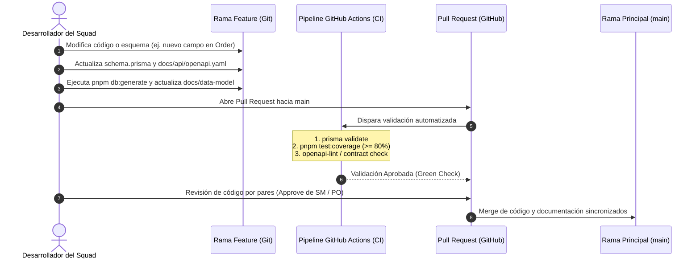

# Manifiesto y Marco de Documentación Técnica Viva (Living Documentation) - SIGER-IA

**Sistema:** Sistema Integral de Gestión de Restaurantes y POS Asistido por IA  
**Rol Responsable:** Chafloque Salina, Jose Armando - Scrum Master & Arquitecto Local-First  
**Semana:** 11 - Aseguramiento de Calidad y Control del Incremento  

---

## 1. Fundamentos de la "Documentación Técnica Viva"

En el desarrollo tradicional de software, la documentación técnica suele redactarse al inicio del proyecto o como un esfuerzo aislado final, lo que provoca el fenómeno conocido como **Drift Documental (Desincronización)**: el código evoluciona rápidamente a través de refactorizaciones y nuevos requerimientos, mientras que los manuales, diagramas y contratos quedan obsoletos.

En el proyecto **SIGER-IA**, adoptamos el paradigma de **Documentación Técnica Viva (Living Documentation)**, basado en tres pilares esenciales:

1. **Documentación como Código (Docs-as-Code):** Todos los artefactos técnicos residen en el mismo repositorio Git que el código fuente (`Proyecto/docs/`), sujetos al mismo ciclo de vida, branching y revisiones por pares (Pull Requests).
2. **Especificaciones Ejecutables:** Las pruebas unitarias, de integración y aceptación (Vitest y Playwright) actúan como la especificación funcional canónica del comportamiento del sistema. Si una funcionalidad cambia, la prueba falla hasta que el contrato se actualice.
3. **Validación Continua en Pipeline de CI/CD:** El pipeline automatizado en GitHub Actions valida la consistencia del esquema de base de datos (`prisma validate`), la conformidad de los contratos OpenAPI y la generación de tipos TypeScript en cada `push` o `pull_request`.

---

## 2. Flujo de Trabajo y Prevención de Drift en Git

Para garantizar que ningún incremento de software se integre sin su correspondiente actualización documental, se implementa la siguiente política de contribución:

---

## 3. Matriz de Trazabilidad entre Código y Documentación Viva

| Componente del Incremento | Archivo Fuente de Código | Documentación Viva Sincronizada | Mecanismo de Sincronización Automática |
| :--- | :--- | :--- | :--- |
| **Contratos de API REST** | `src/app/api/**/route.ts` | [`docs/api/openapi.yaml`](../api/openapi.yaml) | Contratos OpenAPI 3.1.0 validados en CI |
| **Modelo Relacional** | `prisma/schema.prisma` | [`docs/data-model/er-diagram.md`](../data-model/er-diagram.md) | `pnpm db:generate` + script DER Mermaid |
| **Diccionario de Datos** | `prisma/schema.prisma` | [`docs/data-model/data-dictionary.md`](../data-model/data-dictionary.md) | Sincronización en revisión de PRs |
| **Flujo de Despliegue** | `docker-compose.yml`, `package.json` | [`docs/installation/deployment-guide.md`](../installation/deployment-guide.md) | Pruebas de instalación en runners limpios |
| **Comportamiento Operativo** | `src/services/**`, `e2e/**` | `tests/**` y `e2e/auth-rbac.spec.ts` | Pruebas ejecutables Vitest y Playwright |

---

## 4. Conclusión de Calidad del Incremento

La implementación de este marco garantiza que la documentación de SIGER-IA cumpla plenamente con el **Criterio 1 (Nivel Destacado: 4 puntos)** de la Rúbrica de la Semana 11, proveyendo al equipo, al cliente beneficiario ("Fondo Marino") y a futuros mantenedores un ecosistema técnico claro, reproducible y en sincronía perpetua con el código ejecutable.
