# Modelo de Datos Relacional - SIGER-IA

**Sistema:** Sistema Integral de Gestión de Restaurantes y Punto de Venta Asistido por IA  
**Base de Datos:** SQLite / PostgreSQL (Gestionado a través de Prisma ORM v6)  
**Versión del Esquema:** 1.2.0 (Verificado contra `prisma/schema.prisma`)  
**Última Actualización:** Semana 11 - Ciclo 2026-II  

---

## 1. Diagrama Entidad-Relación (DER)

A continuación se presenta la arquitectura relacional completa del sistema SIGER-IA modelada en Mermaid, contrastada al 100% con las 15 tablas de `schema.prisma`:

```mermaid
erDiagram
    users ||--o{ orders : "registra (userId)"
    users ||--o{ invoices : "emite (issuedBy)"
    users ||--o{ printers : "crea/actualiza"
    users ||--o{ cash_sessions : "abre/cierra turno (US-10)"

    tables ||--o{ orders : "contiene (tableId)"

    categories ||--o{ products : "agrupa (categoryId)"

    products ||--o{ order_items : "incluye (productId)"
    products ||--o| recipes : "especifica (productId)"

    orders ||--|{ order_items : "se compone de (orderId)"
    orders ||--o| invoices : "se liquida en (orderId)"

    invoices ||--|{ invoice_items : "desglosa (invoiceId)"

    ingredient_categories ||--o{ ingredients : "clasifica (categoryId)"

    ingredients ||--o{ recipe_ingredients : "aporta insumo (ingredientId)"
    recipes ||--|{ recipe_ingredients : "requiere (recipeId)"

    users {
        string id PK "CUID"
        string username UK "Identificador de acceso (jefe / mesero)"
        string name "Nombre del colaborador"
        string password "Hash bcrypt"
        string role "JEFE | MESERO (default: MESERO)"
        boolean isActive "Estado de cuenta"
        datetime createdAt
        datetime updatedAt
    }

    tables {
        string id PK "CUID"
        int number UK "Número físico de mesa (1 al 12 en seed)"
        int capacity "Capacidad de comensales (2, 4, 6)"
        string status "DISPONIBLE | OCUPADA | ESPERANDO | MANTENIMIENTO"
        boolean isActive
        datetime createdAt
        datetime updatedAt
    }

    categories {
        string id PK "CUID"
        string name UK "Especiales Carne/Pollo, Bebidas, Alitas, Carta, etc."
        string description
        boolean isActive
        datetime createdAt
        datetime updatedAt
    }

    products {
        string id PK "CUID"
        string name "Nombre del plato/bebida"
        string description
        decimal price "Precio de venta en Soles (PEN)"
        boolean isAvailable "Disponibilidad de despacho"
        boolean isActive
        string categoryId FK
        datetime createdAt
        datetime updatedAt
    }

    orders {
        string id PK "CUID"
        string orderNumber UK "Correlativo de comanda"
        string type "MESA | PARA_LLEVAR | DELIVERY"
        string status "PENDING | CONFIRMED | PREPARING | READY | SERVED | COMPLETED | CANCELLED"
        decimal totalAmount "Monto acumulado"
        string tableId FK "Mesa asociada (nullable)"
        string userId FK "Usuario responsable"
        string customerName "Nombre de cliente opcional"
        string customerDni "DNI para comanda"
        string notes "Indicaciones generales"
        datetime startDate
        datetime endDate
        datetime createdAt
        datetime updatedAt
    }

    order_items {
        string id PK "CUID"
        int quantity "Cantidad solicitada"
        decimal unitPrice "Precio unitario histórico"
        decimal subtotal "quantity * unitPrice"
        string notes "Modificadores culinarios"
        string status "PENDING | PREPARING | READY | SERVED"
        string orderId FK "Cascade on delete"
        string productId FK
        datetime createdAt
        datetime updatedAt
    }

    invoices {
        string id PK "CUID"
        string number UK "Correlativo fiscal (B001-XXXX / F001-XXXX)"
        string type "BOLETA | FACTURA"
        string orderId FK "Orden liquidada (1:1)"
        string customerName "Razón social o cliente"
        string customerRuc "RUC / DNI"
        decimal subtotal "Base imponible"
        decimal igv "Impuesto general a las ventas (18%)"
        decimal total "Monto total cancelado"
        string paymentMethod "EFECTIVO | YAPE | PLIN | TARJETA"
        decimal amountPaid "Monto entregado por cliente"
        decimal change "Vuelto entregado"
        string issuedBy FK "Cajero/Jefe responsable"
        string status "ISSUED | CANCELLED"
        datetime issuedAt
    }

    invoice_items {
        string id PK "CUID"
        string invoiceId FK "Cascade on delete"
        string description "Descripción del concepto facturado"
        int quantity "Cantidad"
        decimal unitPrice "Precio unitario"
        decimal total "Total de línea"
    }

    ingredient_categories {
        string id PK "CUID"
        string name UK "Familias de clasificación"
        string description
        string color "Código hex para badges"
        boolean isActive
        datetime createdAt
        datetime updatedAt
    }

    ingredients {
        string id PK "CUID"
        string name UK "Ej: Papas, Pollo, Pescado"
        string unit "kg | unidades | lt"
        float currentStock "Stock físico actual"
        float minStock "Punto de reorden"
        float cost "Costo unitario promedio"
        string categoryId FK
        boolean isActive
        datetime createdAt
        datetime updatedAt
    }

    recipes {
        string id PK "CUID"
        string productId UK "1:1 con Producto"
        string instructions "Pauta de preparación en cocina"
        int prepTime "Tiempo estimado (minutos)"
        int servings "Porciones rendidas"
        boolean isActive
        datetime createdAt
        datetime updatedAt
    }

    recipe_ingredients {
        string id PK "CUID"
        string recipeId FK "Cascade on delete"
        string ingredientId FK
        float quantity "Dosis requerida por receta"
        string unit "Unidad de medida de receta"
        string notes
        datetime createdAt
        datetime updatedAt
    }

    printers {
        string id PK "CUID"
        string name "Cocina Principal / Caja Principal"
        string type "KITCHEN | RECEIPT"
        string connectionType "NETWORK | BLUETOOTH | USB"
        string ipAddress "IP en red local (192.168.0.100 en seed)"
        int port "Puerto raw TCP (9100)"
        int paperWidth "Ancho en mm (58)"
        int charactersPerLine "32 columnas"
        string charset "PC437"
        boolean isDefault
        string status "ACTIVE | INACTIVE"
        string createdBy FK
        datetime createdAt
        datetime updatedAt
    }

    cash_sessions {
        string id PK "CUID"
        string status "ABIERTA | CERRADA (un solo turno abierto)"
        decimal openingAmount "Fondo inicial"
        datetime openedAt
        string openedById FK
        datetime closedAt "Nullable"
        string closedById FK "Nullable"
        decimal declaredAmount "Efectivo contado (arqueo ciego)"
        decimal cashSales "Ventas EFECTIVO del turno"
        decimal expectedAmount "Fondo + ventas en efectivo"
        decimal difference "Declarado - esperado"
        decimal otherSales "Yape, Plin, tarjeta, transferencia"
        int invoiceCount
        string notes
    }

    system_config {
        string id PK "default"
        string companyName "Mr Frit / Fondo Marino"
        string companyAddress "Calle Las Gaviotas 1311, Trujillo"
        string companyRuc "10428072265"
        float taxRate "0.18"
        string currency "S/ (PEN)"
        string timezone "America/Lima"
        boolean isPrinterServiceEnabled
        int lastBoletaNumber "Último correlativo emitido"
        int lastFacturaNumber "Último correlativo emitido"
        datetime createdAt
        datetime updatedAt
    }
```

---

## 2. Verificación Directa contra el Código

1. **Usuarios y Roles (`schema.prisma` L19 & `CLAUDE.md` L9):**
   - El modelo define `role String @default("MESERO")`.
   - Los roles canónicos implementados en middleware y sembrados en `seed.ts` son **`JEFE`** y **`MESERO`**.
2. **Tablas e Integridad Referencial:**
   - Todas las 15 tablas son idénticas a las definidas en `schema.prisma`.
   - Se respetan íntegramente las eliminaciones en cascada (`onDelete: Cascade` en `OrderItem`, `InvoiceItem`, `Recipe` y `RecipeIngredient`).
3. **Hardware Térmico:**
   - La impresora de cocina sembrada en `prisma/seed.ts` (L313) opera en red LAN con IP `192.168.0.100:9100` y ancho de papel de 58 mm.
   - La impresora de comprobantes opera vía interfaz Bluetooth.
