# Manual de Usuario — SIGER-IA v1.1.0

**Sistema:** Sistema Integral de Gestión de Restaurantes y POS Asistido por IA
**Versión del sistema:** 1.1.0
**Público:** personal del restaurante (Jefe/Administrador, Mesero, Cocina)
**Capturas:** tomadas del sistema real (`docs/user/img/`), con datos de demostración.

> Para instalar el sistema consulte la [Guía de Inicio Rápido](../installation/quickstart.md).
> Este manual explica **cómo usarlo** en el día a día.

---

## Índice

1. [Ingreso al sistema](#1-ingreso-al-sistema)
2. [Rol JEFE (administrador)](#2-rol-jefe-administrador)
3. [Rol MESERO](#3-rol-mesero)
4. [Cocina: comandas y alertas de tiempo](#4-cocina-comandas-y-alertas-de-tiempo)
5. [Caja: apertura y arqueo ciego](#5-caja-apertura-y-arqueo-ciego)
6. [Preguntas frecuentes (FAQ)](#6-preguntas-frecuentes-faq)

---

## 1. Ingreso al sistema

Abra el navegador en la dirección del servidor del restaurante (por ejemplo `http://192.168.0.10:3001`
desde cualquier equipo de la red local, o `http://localhost:3001` en el mismo servidor).

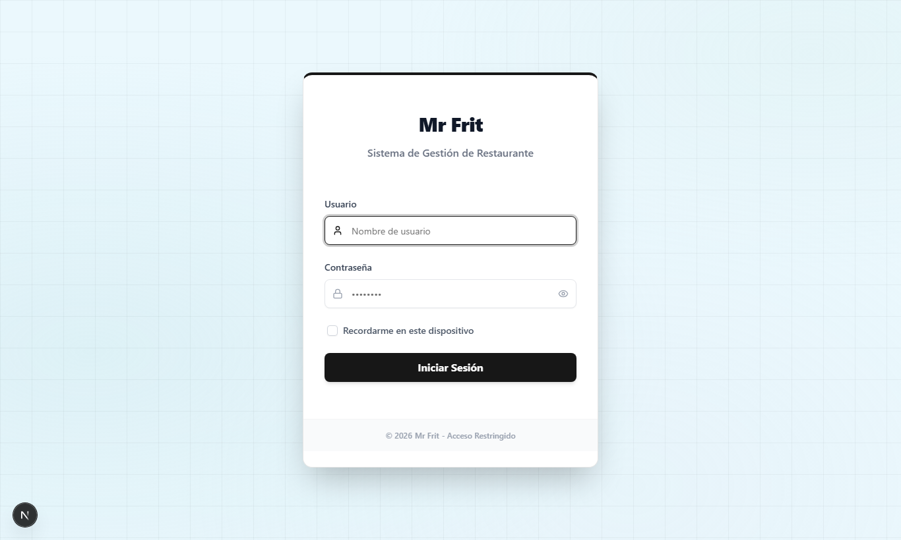

1. Escriba su **usuario** y **contraseña**.
2. Pulse **Ingresar**. El sistema lo lleva a su panel según su rol:
   - **JEFE** → Dashboard (`/dashboard`).
   - **MESERO** → Panel de mesero (`/mesero`).

| Usuario de prueba | Contraseña | Rol |
| :--- | :--- | :--- |
| `jefe` | `admin123` | JEFE |
| `mesero` | `mesero123` | MESERO |

> **Seguridad:** después de **3 intentos fallidos** la cuenta se bloquea **15 minutos**.
> Cambie las contraseñas de prueba antes de usar el sistema con datos reales.

---

## 2. Rol JEFE (administrador)

### 2.1 Dashboard

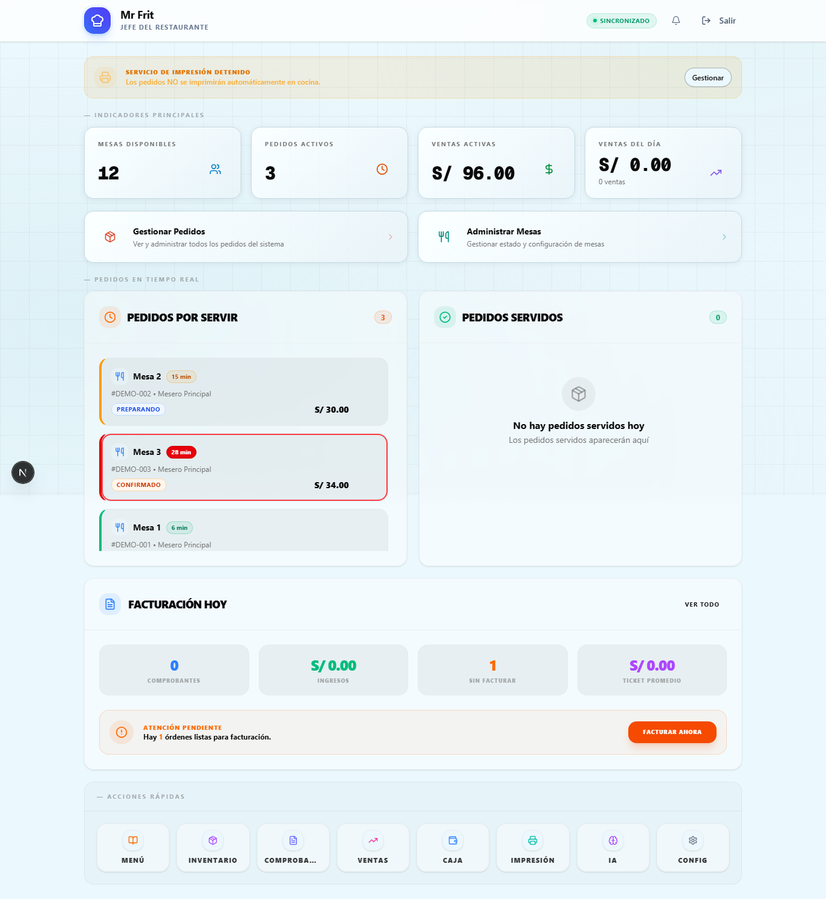

| Zona | Qué muestra |
| :--- | :--- |
| Indicadores principales | Mesas disponibles, pedidos activos, ventas activas y ventas del día. |
| Gestionar Pedidos / Administrar Mesas | Accesos directos a `/pedidos` y `/mesas`. |
| Pedidos por Servir | Pedidos en curso con su **semáforo de tiempo** (ver sección 4). |
| Pedidos Servidos | Pedidos entregados pendientes de cobro. |
| Facturación Hoy | Comprobantes, ingresos y pedidos sin facturar. |
| Acciones rápidas | Menú, Inventario, Comprobantes, Ventas, **Caja**, Impresión, IA y Configuración. |
| Aviso amarillo | Aparece si el servicio de impresión está detenido (los pedidos no saldrán en cocina). |

El indicador **SINCRONIZADO** confirma que la pantalla recibe cambios en tiempo real (Socket.IO).

### 2.2 Pedidos

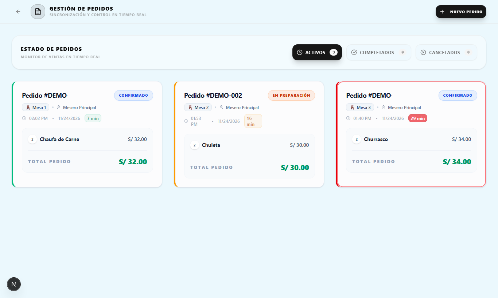

- Pestañas **Activos / Completados / Cancelados** con el número de pedidos de hoy.
- Cada tarjeta muestra mesa o tipo, mesero, hora, minutos de espera, productos y total.
- Al pasar el mouse aparecen las acciones: **ver**, **editar** (pendiente, confirmado o servido),
  **finalizar venta** (servido) y **cancelar** (pendiente o confirmado).
- **Nuevo pedido** abre el formulario de la sección 3.2.

**Finalizar venta (cobro):** en un pedido *Servido* pulse ✔, elija **Boleta**, **Factura** o sin comprobante,
el método de pago (Efectivo, Tarjeta, Transferencia, Yape o Plin) y el **monto recibido**; el sistema calcula el vuelto.
Para factura se exige RUC de 11 dígitos (se autocompleta la razón social cuando hay conexión).

### 2.3 Mesas

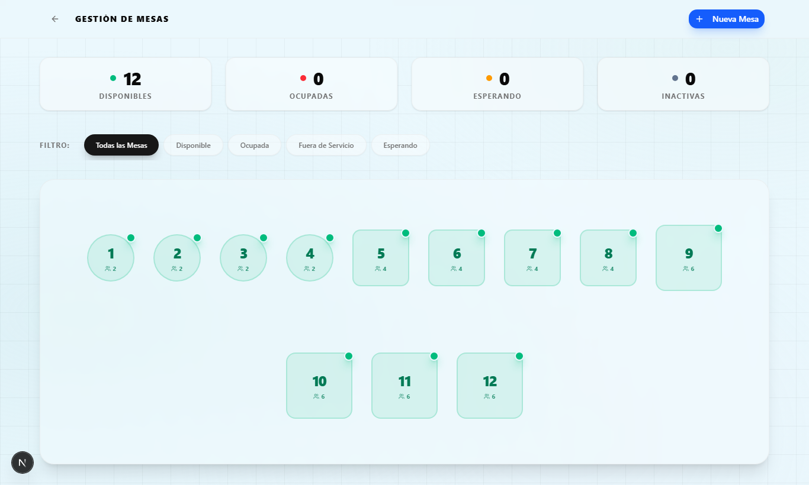

Estados: **Disponible** (verde), **Ocupada** (rojo), **Esperando** y **Fuera de servicio**.
El JEFE puede crear mesas, editar su capacidad y cambiar su estado.

### 2.4 Menú

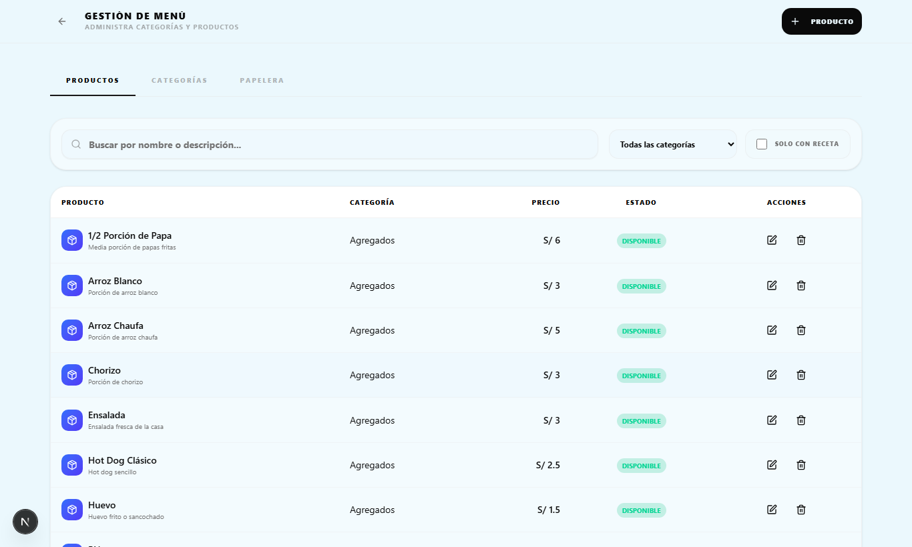

Alta, edición y desactivación de productos por categoría, con precio, disponibilidad y **receta**
(ingredientes y cantidades). Al servir un pedido, el sistema descuenta del inventario los insumos de la receta.

### 2.5 Inventario

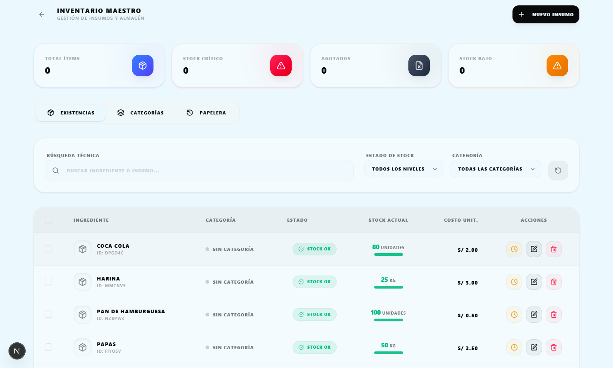

Insumos por categoría con stock actual, stock mínimo y costo. Los insumos por debajo del mínimo
generan alertas en el dashboard (campana de notificaciones).

### 2.6 Comprobantes

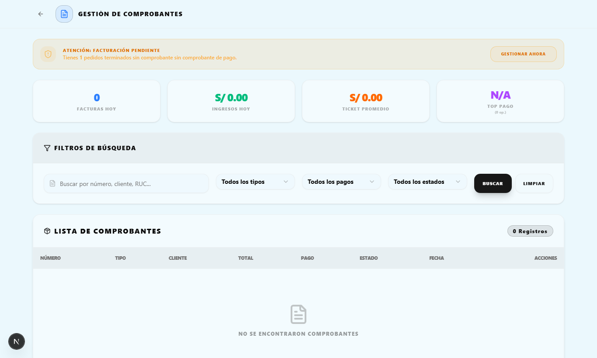

Lista de boletas y facturas con filtros por tipo, método de pago, estado y texto (número, cliente o RUC).
Desde el detalle se puede **reimprimir**, **enviar por correo** o **anular** indicando el motivo.

### 2.7 Ventas

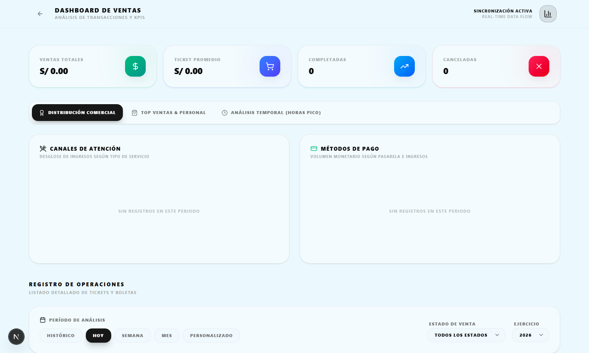

Historial de ventas con KPIs, filtros por fecha y año, gráficos y detalle de cada venta.

### 2.8 Impresión

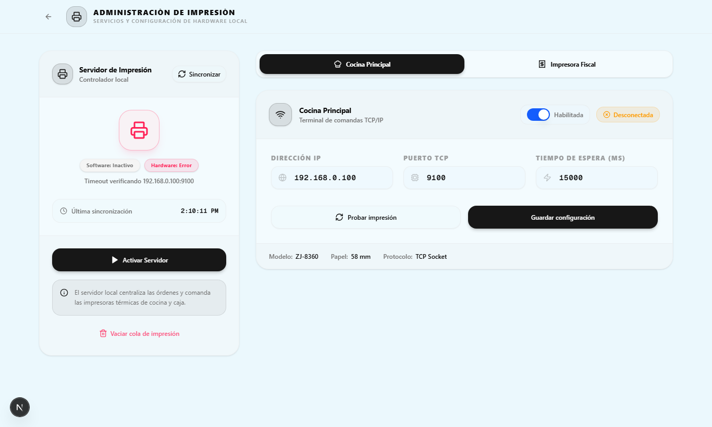

Configuración de impresoras térmicas ESC/POS (red LAN, USB o Bluetooth), prueba de impresión y
encendido del servicio de impresión. La impresora de cocina por defecto es `192.168.0.100:9100`.

### 2.9 Inteligencia (IA)

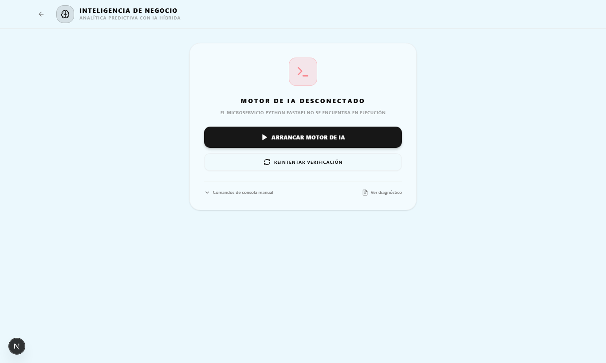

Requiere el motor de IA (servicio Python). Si aparece **Motor de IA desconectado**, pulse
**Arrancar motor de IA**. Una vez activo ofrece:

- Pronóstico de demanda por producto.
- Productos que se venden juntos (canasta de mercado).
- Predicción de inventario.
- Chat con el asistente (necesita una clave de Gemini cargada en Configuración).

El POS funciona con normalidad aunque la IA esté apagada.

### 2.10 Configuración

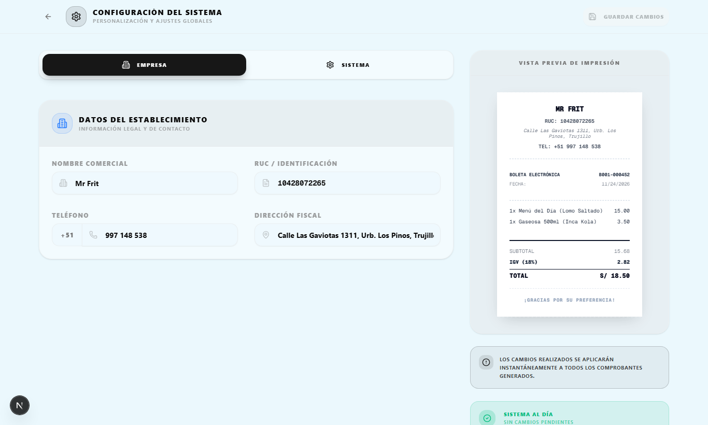

Datos de la empresa (nombre, RUC, dirección, teléfono), tasa de IGV, moneda y clave de Gemini.

### 2.11 Usuarios

Dashboard → **Usuarios**. Lista las cuentas con su rol y estado.

- **Cambiar contraseña:** pulse *Cambiar contraseña*, escriba la nueva dos veces y *Guardar*.
  Mínimo 8 caracteres, con letras y números. **Cambie las contraseñas iniciales** (`admin123`,
  `mesero123`) el primer día de uso.
- **Activa:** desactive la cuenta de alguien que ya no trabaja en el local; no podrá ingresar.
  Su propia cuenta no se puede desactivar.
- **Bloqueada por intentos:** tras 3 contraseñas incorrectas la cuenta se bloquea 15 minutos,
  aunque se reinicie el servidor. Para desbloquearla antes, cámbiele la contraseña.

---

## 3. Rol MESERO

### 3.1 Panel del mesero

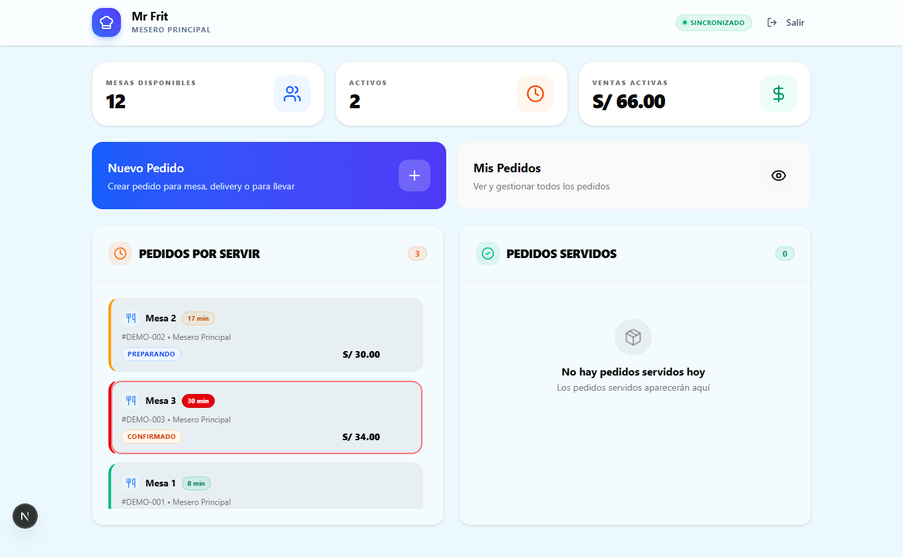

Muestra mesas disponibles, pedidos activos y ventas activas, los accesos **Nuevo Pedido** y
**Mis Pedidos**, y los widgets *Pedidos por Servir* (con semáforo de tiempo) y *Pedidos Servidos*.

### 3.2 Tomar un pedido

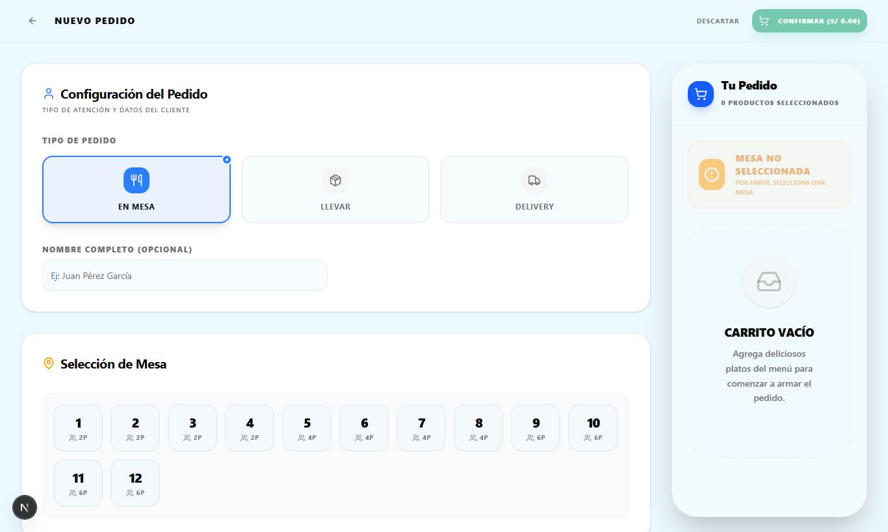

1. Elija el tipo: **En mesa**, **Llevar** o **Delivery**.
2. En mesa: seleccione la mesa. En delivery: ingrese teléfono y dirección.
3. Agregue productos del catálogo (búsqueda y categorías); ajuste cantidades y notas (por ejemplo, "sin ají").
4. Pulse **Confirmar**. La comanda se imprime en cocina y aparece en todas las pantallas al instante.

Un pedido puede **editarse** mientras no esté completado; los cambios también se imprimen en cocina.

---

## 4. Cocina: comandas y alertas de tiempo

La cocina recibe cada pedido como **comanda impresa** y lo ve en *Pedidos por Servir*.
Cada pedido en curso (pendiente, confirmado o en preparación) muestra los **minutos de espera** con un semáforo:

| Color | Tiempo desde que se tomó el pedido | Acción sugerida |
| :--- | :--- | :--- |
| 🟢 Verde | menos de 10 min | En tiempo. |
| 🟠 Ámbar | de 10 a 18 min | Priorizar. |
| 🔴 Rojo (contorno parpadeante + bip) | más de 18 min | Atender de inmediato. |

- El tiempo se actualiza solo cada 30 segundos.
- El **bip** suena una sola vez por pedido cuando pasa a rojo. Si el navegador lo bloquea,
  haga clic una vez en la página para habilitar el sonido.
- Los pedidos **listos**, **servidos**, **completados** o **cancelados** no muestran semáforo.

---

## 5. Caja: apertura y arqueo ciego

Ruta: Dashboard → **Caja** (solo JEFE).

**Arqueo ciego** significa que, mientras el turno está abierto, el sistema **no muestra** cuánto dinero
debería haber. Así quien cuenta el efectivo no se guía por el sistema y los descuadres salen a la luz.

**Abrir turno**

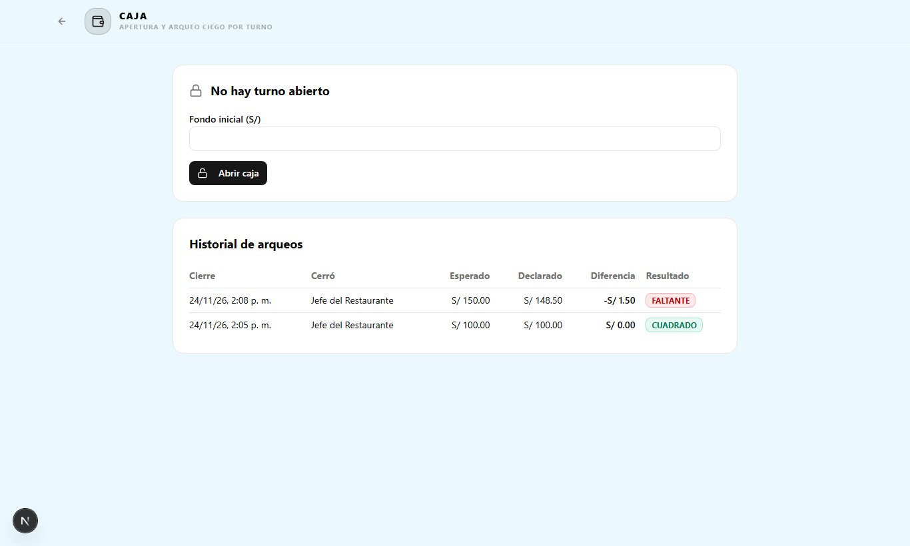

1. Cuente el sencillo con el que empieza la caja.
2. Escríbalo en **Fondo inicial (S/)** y pulse **Abrir caja**.
   Solo puede haber un turno abierto a la vez.

**Cerrar turno (arqueo)**

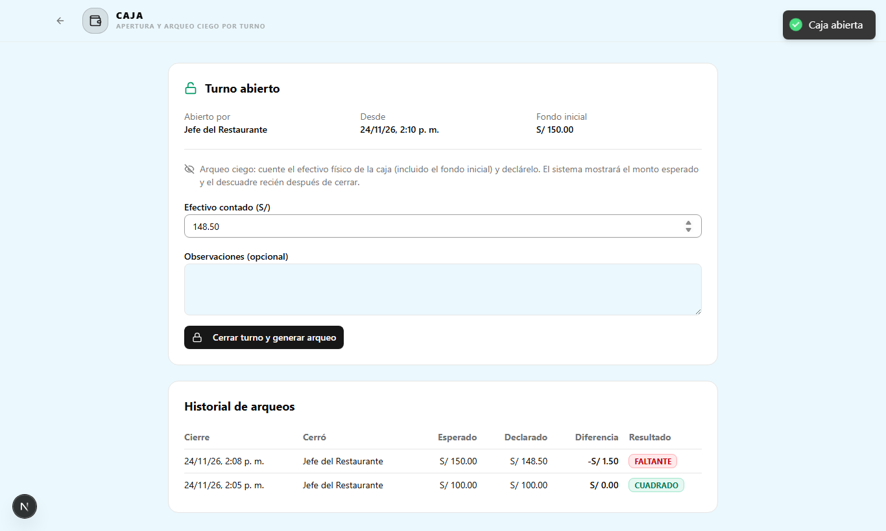

1. Al terminar el turno, cuente **todo** el efectivo de la caja (incluido el fondo inicial).
2. Escríbalo en **Efectivo contado (S/)**, agregue observaciones si hace falta y pulse
   **Cerrar turno y generar arqueo**.

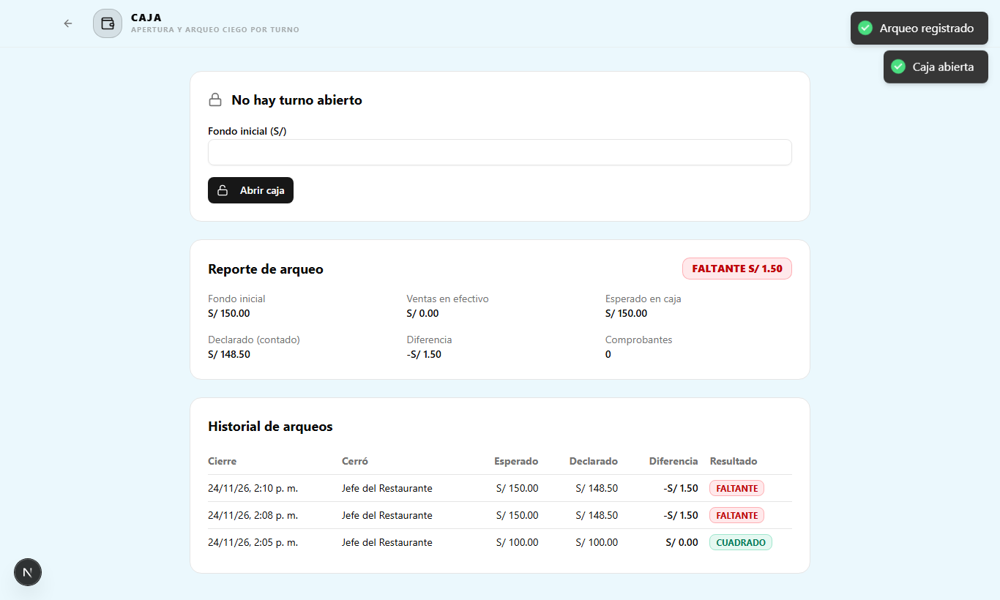

El reporte muestra:

| Campo | Cálculo |
| :--- | :--- |
| Esperado en caja | Fondo inicial + ventas en **efectivo** del turno (no cuenta comprobantes anulados). |
| Declarado | Lo que usted contó. |
| Diferencia | Declarado − esperado. |
| Resultado | **CUADRADO** (0), **SOBRANTE** (> 0) o **FALTANTE** (< 0). |
| Ventas por método | Yape, Plin, tarjeta y transferencia van aparte: no están en el cajón. |

El **Historial de arqueos** conserva los últimos turnos cerrados para revisión.

---

## 6. Preguntas frecuentes (FAQ)

**¿Qué hago si olvidé la contraseña o se bloqueó la cuenta?**
Tras 3 intentos fallidos espere 15 minutos. Si la olvidó, el JEFE (o soporte técnico) debe restablecerla.

**El pedido no salió impreso en cocina.**
Revise el aviso amarillo del dashboard. En **Impresión** verifique que el servicio esté activo y pruebe
la impresora (`ping 192.168.0.100`). Puede reimprimir la comanda desde el detalle del pedido.

**Las pantallas no se actualizan solas.**
Verifique que el indicador diga **SINCRONIZADO**. Si no, recargue la página (F5) y confirme que el
equipo está en la misma red Wi-Fi que el servidor.

**Se fue el internet, ¿sigo vendiendo?**
Sí. El sistema es *local-first*: pedidos, cobros, impresión y caja funcionan sin internet.
Solo se detienen las consultas de DNI/RUC, el envío de comprobantes por correo y el chat con IA.

**El semáforo no suena.**
Los navegadores bloquean el audio hasta que el usuario interactúa. Haga clic una vez en la página.
La alerta visual siempre funciona.

**El arqueo salió con FALTANTE o SOBRANTE.**
Revise si hubo cobros en efectivo registrados con otro método (o al revés), vueltos mal entregados
o comprobantes anulados después de cobrar. Anote la explicación en *Observaciones* del siguiente cierre.

**La sección IA dice "Motor de IA desconectado".**
Pulse **Arrancar motor de IA**. Si no arranca, en el servidor ejecute `pnpm ai:start`.
El resto del sistema no depende de la IA.

**¿Cómo respaldo la información?**
En el servidor ejecute `pnpm db:backup` (copia fechada en `backups/`) o `pnpm db:backup:usb` para
copiar también a una memoria externa. Se recomienda un respaldo diario al cierre.
